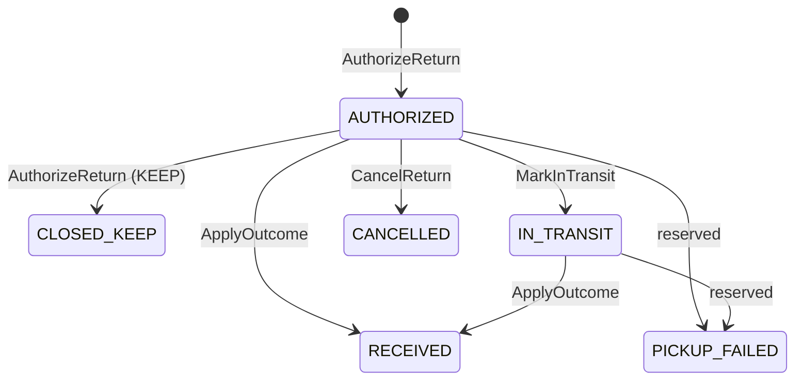

# Aggregate Design Canvas

Following the ddd-crew [Aggregate Design Canvas v1.1](https://github.com/ddd-crew/aggregate-design-canvas). One
aggregate root: **ReturnAuthorization**. Go package `internal/domain/returnauthorization`, with the read-model value
types in `internal/domain/network` and the shared event/error types in `internal/domain/shared`. The aggregate is
rebuilt from a `Snapshot` by `Restore` (`checkSnapshot`), which re-validates every invariant, and carries an
optimistic-concurrency `version` (`409 concurrent-update` on a lost race). Decisions:
[ADR 0002](/docs/adr/0002-aggregates-and-invariants).

## ReturnAuthorization

**Description.** The shopper-facing authorization of one order group's return, with the disposition decided AT
authorization. Identified by `authorizationId` (`ret-<uuid>`, minted by the service). Value objects: `Line` (with
`lineNo`, `catalogItemId`, `quantity`, optional `unitPriceCents`, `ownerRef`), `Reason`, `Disposition`
(`KEEP`, `NEAREST_RETURNS_CENTER`, `ORIGIN_NODE`), `Method` (`DROP_OFF`, `PICKUP`), `CancelReason`
(`SHOPPER_REQUESTED`, `EXPIRED`) and `OutcomeLine` (with `qtyRestockable`, `qtyUnsellable`).

Source: `internal/domain/returnauthorization/{authorization,commands,decide,invariants}.go`.

| Invariant | Error |
| --- | --- |
| 1 to `MaxLinesPerReturn` = 50 lines; `quantity` at least 1; a known reason, disposition and method; `expiresAt = authorizedAt + ReturnAuthorizationTTL` (30 days) | `ErrValidation` |
| `Decide` found neither a returns centre for the region nor an origin node (and KEEP did not apply) | `ErrNoReturnDestination` |
| KEEP ⇒ no destination, no label, `CLOSED_KEEP` at once | schema CHECKs |
| PICKUP ⇒ window inside `[authorizedAt, expiresAt]`, both bounds, disposition not KEEP; DROP_OFF carries no window | schema CHECKs |
| At most `MaxPackagesPerReturn` = 5 tracking numbers, each linked once | `ErrValidation` on `LinkLabel` |
| Cancel only while `AUTHORIZED`; label only an open physical authorization; outcome only while `AUTHORIZED` or `IN_TRANSIT`; transit requires a linked label | `ErrIllegalTransition` |
| An outcome's per-item `qtyRestockable + qtyUnsellable` never exceeds the authorized quantity, and each item appears once | `ErrValidation` on `ApplyOutcome` |

The REST problem of each error is in the catalogue (`internal/adapters/inbound/http/errors.go`):
`validation-failed` 422, `no-return-destination` 422, `illegal-transition` 409, plus the use-case problems
`group-not-shipped` 422, `label-unavailable` 422, `authorization-expired` 422, `not-found` 404 and
`concurrent-update` 409.

**Commands:** `AuthorizeReturn` (REST; runs `Decide`), `IssueLabel` (REST; calls the shipping context, then
`LinkLabel`), `CancelReturn` (REST; `Cancel`), `OnOutcomeSubmitted` (Kafka consumer; `ApplyOutcome`). `MarkInTransit`
and `MarkPickupFailed` raise no event and have no driving adapter in v1 — transit is observed, not commanded, and the
pickup wave has not shipped ([ADR 0002](/docs/adr/0002-aggregates-and-invariants)).
**Events:** `ReturnAuthorized`, `ReturnLabelIssued`, `ReturnCompleted`, `ReturnCancelled`.
**Throughput:** one per returned group (a subset of all shipped groups). **Size:** one row plus its lines (JSONB).

One aggregate is a consistency choice: the disposition, its labels and its outcome are one transactional fact — the
outcome must fit what was authorized, and the label count belongs to the authorization. Everything else the decision
needs is other contexts' facts, kept in read models outside the aggregate boundary.

## Read models

| Read model | Table | Fed by |
| --- | --- | --- |
| `OrderGroupView` | `order_group_views` | `CustomerOrderPlaced` (each group's lines and witness, the order's prefix; `PROMISED`), the terminal `ShopperNoticeDecided` families (status) |
| `ReturnsNetworkView`, node half | `returns_network_nodes` | `NodeRegistered` (type, region), `NodeActivated`, `NodeSuspended`, `NodeRetired` (the lifecycle only; only ACTIVE `RETURNS_CENTER`s are `Decide` candidates) |
| `ReturnsNetworkView`, prefix half | `service_area_prefixes` | `ServiceAreaAssigned` (highest `assignmentVersion` wins; a stale write is a no-op) |
| `ReturnsNetworkView`, origin half | `group_origins` | `FulfillmentLocked` (the fulfilling node), `FulfillmentReleasedToNode` (the per-item `ownerRef`s) |
| Outcome facts | `return_outcomes` | `VendorReturnOutcomeSubmitted` — the raw graded outcomes with per-line `unexpected` flags; the audit trail, nothing re-decides an authorization from them |
