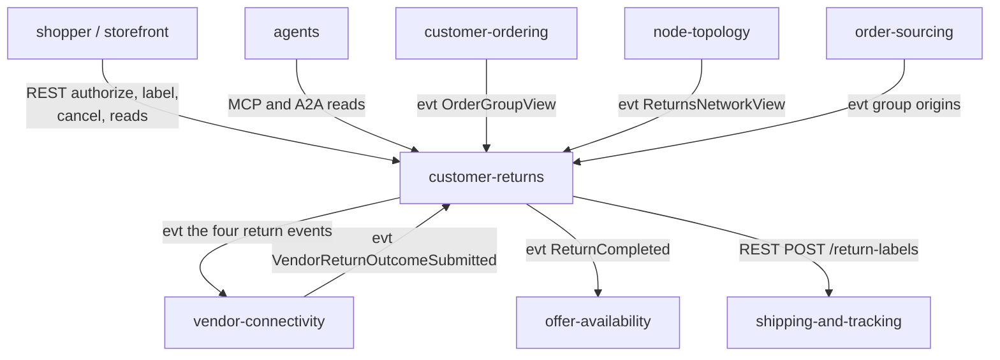

# Bounded Context Canvas

Following the ddd-crew [Bounded Context Canvas](https://github.com/ddd-crew/bounded-context-canvas).

Source: `internal/adapters/inbound/{http,kafka,mcp,a2a}`, `internal/adapters/outbound/{kafka,labels}`,
`apis/asyncapi.yaml`.

## 1. Name

Customer Returns (`customer-returns`, `CR`), tier `commerce`, Supporting.

## 2. Purpose

After a customer order group has shipped or been delivered, let its shopper return it: decide here what happens to the
goods (returnless KEEP, the region's returns centre, or the node that fulfilled the order), issue the reverse label
through the shipping context, and close the loop on the returns centre's graded outcome — holding no money, no address
and no free text ([ADR 0001](/docs/adr/0001-customer-returns-bounded-context)).

## 3. Strategic classification

| Axis | Value |
| --- | --- |
| Domain | Supporting |
| Business model | Service enabler |
| Evolution | Custom-built |

See [Subdomain classification](/docs/ddd/subdomain-classification).

## 4. Domain roles

Decision maker (the disposition is decided here, never by the caller), Execution (authorization, label, cancellation,
outcome), Gateway for shoppers (Open Host Service behind the storefront).

## 5. Inbound communication

| Sender | Type | Message | Channel | Relationship |
| --- | --- | --- | --- | --- |
| shopper / storefront | command | `AuthorizeReturn` | REST `POST /return-authorizations` | OHS |
| shopper / storefront | command | `IssueLabel` | REST `POST /return-authorizations/{authorizationId}/labels` | OHS |
| shopper / storefront | command | `CancelReturn` | REST `POST /return-authorizations/{authorizationId}/cancellations` | OHS |
| shopper / storefront | query | `GetReturnAuthorization`, `ListReturnAuthorizations` | REST `GET /return-authorizations/{authorizationId}`, `GET /return-authorizations?orderId=` (keyset-paged) | OHS |
| agents | query | the two reads above | MCP `get_return_authorization`, `list_return_authorizations`; A2A skill `get_return_authorization` | read-only, unauthenticated |
| `customer-ordering` | event | `CustomerOrderPlaced`, `ShopperNoticeDecided` | Kafka `retailnetwork.customer-ordering.events` | Conformist |
| `node-topology` | event | `NodeRegistered`, `NodeActivated`, `NodeSuspended`, `NodeRetired`, `ServiceAreaAssigned` | Kafka `retailnetwork.node-topology.events` | Conformist |
| `order-sourcing` | event | `FulfillmentReleasedToNode`, `FulfillmentLocked` | Kafka `retailnetwork.order-sourcing.events` | Conformist |
| `vendor-connectivity` | event | `VendorReturnOutcomeSubmitted` | Kafka `retailnetwork.vendor-connectivity.events` | Customer/Supplier |

All write routes take an `Idempotency-Key`. No authentication, as in every other context of the fleet.

## 6. Outbound communication

| Message | Type | Consumers |
| --- | --- | --- |
| `ReturnAuthorized` | event | vendor-connectivity (opens the return advice) |
| `ReturnLabelIssued` | event | vendor-connectivity |
| `ReturnCompleted` | event | offer-availability (restocks listings), vendor-connectivity |
| `ReturnCancelled` | event | vendor-connectivity |

This context makes **exactly one synchronous call**: the shipping context's reverse-label route
([ADR 0005](/docs/adr/0005-the-reverse-label-route)), config-gated by `SHIPPING_LABELS_URL` and tolerant when absent.

## 7. Ubiquitous language

See [Ubiquitous language](/docs/ddd/ubiquitous-language).

## 8. Business decisions

See [Introduction](/docs/overview/introduction#business-rules-in-one-place) and [Use cases](/docs/ddd/use-cases). The
rules as policies, named in the model: `Decide` (the pure disposition function: returnless threshold, returns-centre
selection, origin fallback), `AuthorizeOnlyShippedGroups`, `LazyExpiry`, `FirstFittingOutcome`,
`UnexpectedLinesStayFacts`. In code: `Decide` and `DecideInput` (`internal/domain/returnauthorization/decide.go`),
`expireLazily` and `expireAndReject` (ADR 0002 A4), `commitOutcome` with `factOf` and `allUnexpected`
(ADR 0002 A6 and A7).

## 9. Assumptions

- The order group, network and origin facts arrive as events before the shopper authorizes against them; a lagging read
  model refuses (`group-not-shipped`, `no-return-destination`) rather than guesses — the shopper retries with the same
  `Idempotency-Key`.
- Unit prices are the storefront's facts, stored for the decision and echoed to the caller, never published (the
  no-money rule); an absent price makes KEEP impossible (`pricesAbsent`).
- The assumptions the model left open are settled in [ADR 0002](/docs/adr/0002-aggregates-and-invariants) (its numbered
  assumptions, for example A3 for repeated authorization, A4 for lazy expiry, A6 for the first-fit outcome, A7 for
  unexpected lines).

## 10. Verification metrics

Built: the Tier-2 counter `customer_returns.return.authorized` ([ADR 0008](/docs/adr/0008-fleet-observability-standard))
and the fleet's standard RED metrics on every route. Not built: the share of KEEP dispositions, the `label-unavailable`
rate while the reverse-label route is off, expiries per day, and the time from `ReturnAuthorized` to `ReturnCompleted`.

## 11. Open questions

The last-mile pickup wave (PICKUP activation, `PICKUP_FAILED`, `PackageReturnInitiated`), the refund timing this context
deliberately does not own, what the fleet's exception flow does with unexpected lines, and whether
`ReturnlessThresholdCents` stays a constant or becomes policy ([ADR 0001](/docs/adr/0001-customer-returns-bounded-context),
[ADR 0002](/docs/adr/0002-aggregates-and-invariants)).
