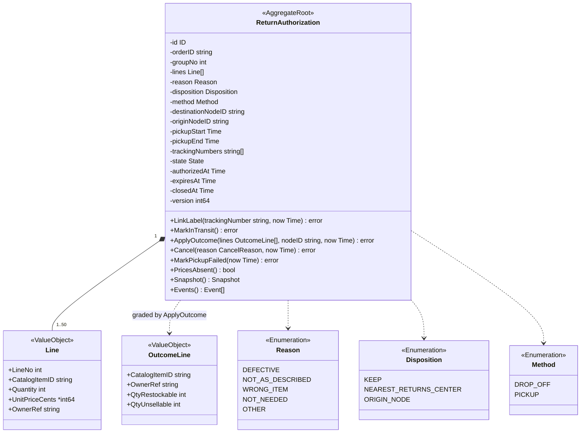
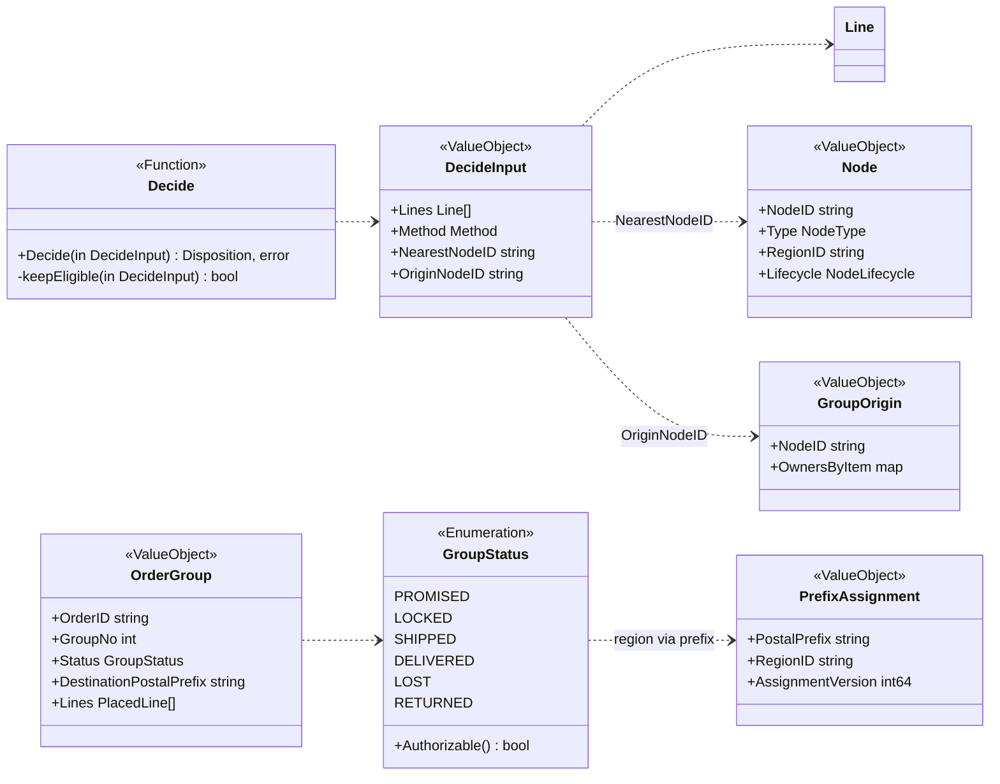
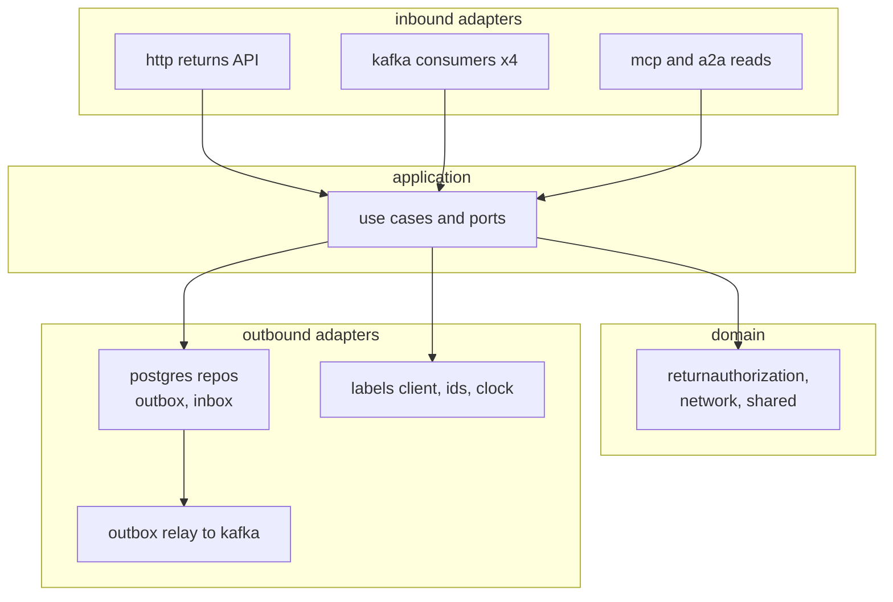

# Class Diagram

UML class diagrams of the domain model. Fields are unexported (`-`), methods exported (`+`); only methods that exist in
the code are listed. The packages are `internal/domain/returnauthorization` (the aggregate, its value objects and
`Decide`), `internal/domain/network` (the read-model value types) and `internal/domain/shared` (the event envelope and
the typed errors). The terms are mapped on [Ubiquitous language](/docs/ddd/ubiquitous-language).

## 1. ReturnAuthorization aggregate

Source: `internal/domain/returnauthorization/{authorization,commands,events,invariants}.go`. `Restore(Snapshot)`
rebuilds the aggregate and re-validates it (`checkSnapshot`). `LinkLabel`, `ApplyOutcome` and `Cancel` raise
`ReturnLabelIssued`, `ReturnCompleted` and `ReturnCancelled`; `MarkInTransit` and `MarkPickupFailed` raise nothing in
v1. `ReturnAuthorized` is raised by the constructor on `AuthorizeReturn`.

## 2. Decide and the read-model types

Source: `internal/domain/returnauthorization/decide.go`, `internal/domain/network/network.go`. `Decide` is pure: it
takes only what the read models resolved, performs no I/O, so the authorize use case is one unit of work. The
`ReturnlessThresholdCents = 1500` constant lives beside it. `shared` holds `Event`, `ErrValidation` and
`ErrIllegalTransition`; the port errors (`ErrNotFound`, `ErrConcurrentUpdate`, `ErrGroupNotShipped`,
`ErrLabelUnavailable`) live in `internal/application/ports`.

## 3. Hexagonal layout

Source: `internal/adapters/{inbound,outbound}`, `internal/application`; the dependency rule is enforced by
`TestHexagonalArchitecture` (see [Testing](/docs/development/testing) and [Architecture](/docs/overview/architecture)).
The `labels` client is the ONLY outbound HTTP adapter ([ADR 0005](/docs/adr/0005-the-reverse-label-route)); the MCP and
A2A adapters wire the read use cases only, never a write seam ([ADR 0006](/docs/adr/0006-read-only-mcp-server)).
