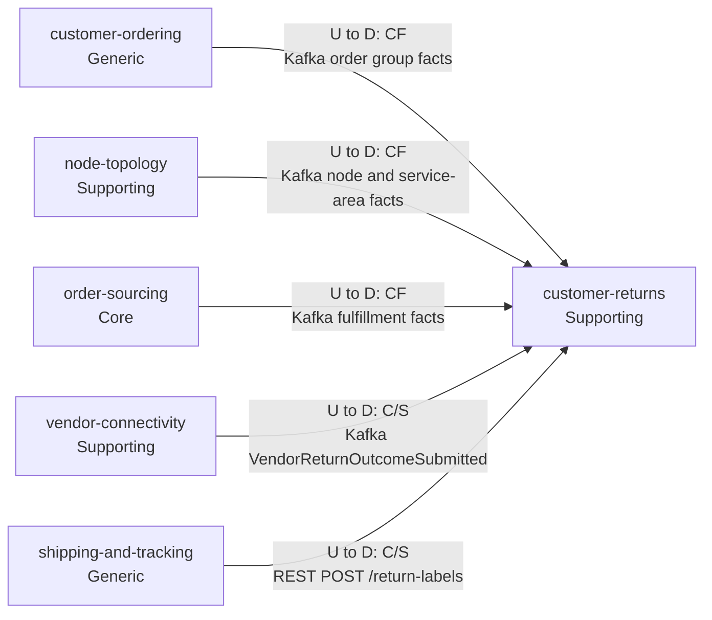
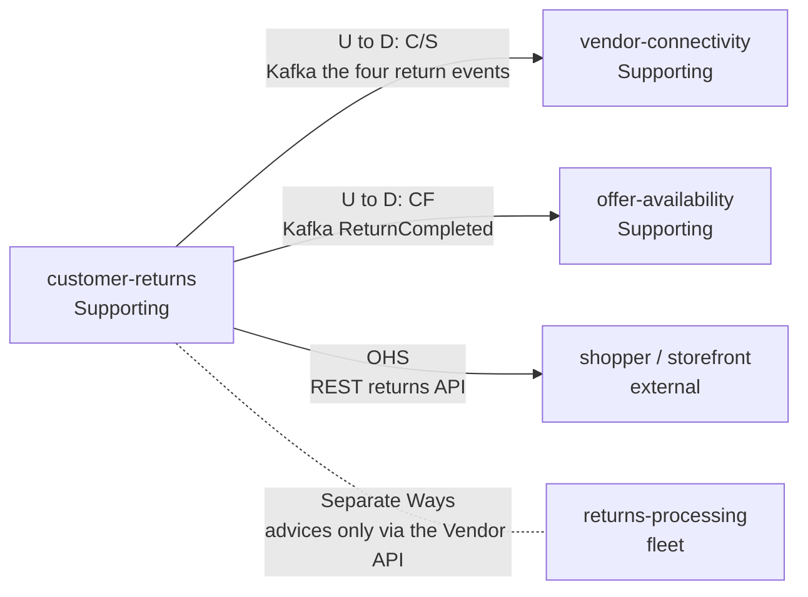

# Context Map

Following ddd-crew [Context Mapping](https://github.com/ddd-crew/context-mapping). This is customer-returns's slice of the
[network-wide context map](https://iqvo.github.io/warehouse-docs/network/strategic-design/context-map). Arrows point from
upstream to downstream.

### Upstream: what customer-returns conforms to

Source: `internal/adapters/inbound/kafka/consumers.go` (topics and types consumed), `internal/adapters/outbound/labels`
(the one HTTP client; [ADR 0005](/docs/adr/0005-the-reverse-label-route)).

### Downstream: who depends on customer-returns

Source: `internal/adapters/outbound/kafka/encoder.go` (topic routing), `internal/adapters/inbound/http/server.go` (REST),
`apis/asyncapi.yaml`.

Omitted: the contexts with no edge to this one, which are Separate Ways: `delivery-promise`, `linehaul-transportation`,
`last-mile-delivery` (until the pickup wave). The service also exposes a read-only MCP server and A2A agent
([API reference](/docs/api-reference)); they add no relationship.

## Relationships

| Neighbour | Direction | Pattern | Channel | Messages | Why this pattern |
| --- | --- | --- | --- | --- | --- |
| `customer-ordering` | U → D | Conformist | Kafka `retailnetwork.customer-ordering.events` | `CustomerOrderPlaced`, `ShopperNoticeDecided` | The group's status and placed lines are customer-ordering's facts. Kept in `order_group_views`; only SHIPPED and DELIVERED are authorizable. |
| `node-topology` | U → D | Conformist | Kafka `retailnetwork.node-topology.events` | `NodeRegistered`, `NodeActivated`, `NodeSuspended`, `NodeRetired`, `ServiceAreaAssigned` | Which nodes are ACTIVE returns centres, and which region a postal prefix belongs to. Kept in `returns_network_nodes` and `service_area_prefixes`. |
| `order-sourcing` | U → D | Conformist | Kafka `retailnetwork.order-sourcing.events` | `FulfillmentReleasedToNode`, `FulfillmentLocked` | Which node fulfilled the group (the lock) and whose stock each item took (the release's `ownerRef`s). Kept in `group_origins`. |
| `vendor-connectivity` | U → D (CR downstream) | Customer/Supplier | Kafka `retailnetwork.vendor-connectivity.events` | `VendorReturnOutcomeSubmitted` | The graded outcome is the published language; customer-returns states what it needs. |
| `vendor-connectivity` | U → D (CR upstream) | Customer/Supplier | Kafka `retailnetwork.customer-returns.events` | `ReturnAuthorized`, `ReturnLabelIssued`, `ReturnCompleted`, `ReturnCancelled` | The Vendor API builds its return advices from these facts; customer-returns publishes what it needs. |
| `offer-availability` | U → D (CR upstream) | Conformist (offer-availability conforms) | Kafka `retailnetwork.customer-returns.events` | `ReturnCompleted` | The restock fact (`qtyRestockable` per item); offer-availability keeps what it needs. |
| `shipping-and-tracking` | U → D | Customer/Supplier (CR the customer) | REST `POST /return-labels` | reverse label request and answer | The one synchronous in-org call: the ship-to is PII the shipping context owns; the route is config-gated and tolerant ([ADR 0005](/docs/adr/0005-the-reverse-label-route)). |
| Shopper / storefront (external) | U → D | Open Host Service | REST (returns API, no auth) | authorize, label, cancel, reads | A published, versionable shopper-facing API behind the storefront. |
| `returns-processing` (warehouse-systems fleet) | none | Separate Ways | none | none | The hard boundary: the fleet works the returns centres' side through the Vendor API of vendor-connectivity only. |

## Notes on the patterns

- **No Shared Kernel.** `orderId`, `nodeId`, `catalogItemId` and `ownerRef` are values copied from events; each consumer
  keeps its own projection and never calls the producer back.
- **Customer/Supplier in both directions with vendor-connectivity, by events only.** The advice flows one way, the
  graded outcome the other; there is no runtime cycle.
- **Exactly one synchronous call.** The reverse-label route is the network-sanctioned exception
  ([ADR 0005](/docs/adr/0005-the-reverse-label-route)); a lagging read model is refused (`group-not-shipped`,
  `no-return-destination`), not slowed ([Integration](/docs/ecosystem/integration)).
