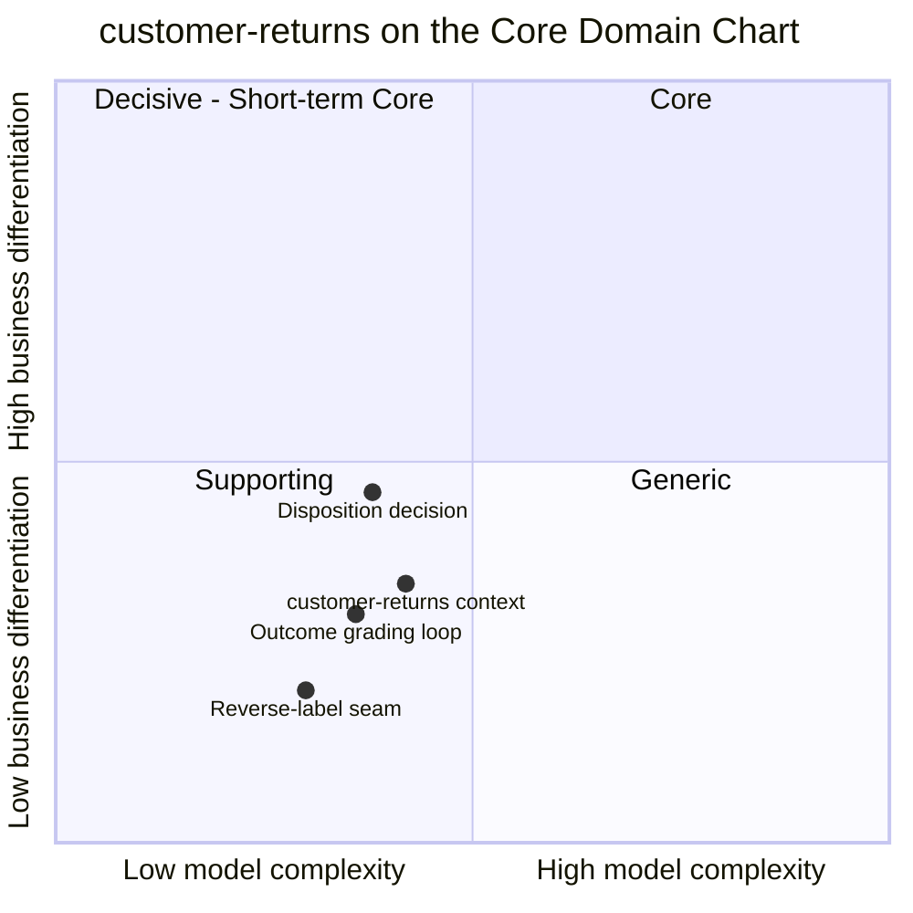

# Core Domain Chart

Following the ddd-crew [Core Domain Charts](https://github.com/ddd-crew/core-domain-charts): business differentiation (y)
against model complexity (x).

Source: the Supporting classification is the model's (`network/model/model.yaml`, in IQVO/warehouse-docs); the
coordinates are this pack's placement, consistent with that classification. The slices correspond to
`internal/domain/returnauthorization/decide.go` (the disposition decision), `internal/adapters/outbound/labels` (the
reverse-label client) and `internal/application/usecases/outcome.go` (the outcome grading loop). The other contexts are
on the [network-wide chart](https://iqvo.github.io/warehouse-docs/network/strategic-design/core-domain-chart).

## Classification: Supporting

The context sits at complexity 0.42, differentiation 0.34: **quadrant 3, Supporting**.

**Differentiation is low (y = 0.34).** The rules are the common practice of reverse logistics: authorize the return of a
shipped order group, give the shopper a label, grade what comes back. The one genuinely commercial slice is the
disposition decision — the returnless `KEEP` threshold, the nearest returns centre, the origin node — and it is a small,
pure function (`Decide`), not a moat. The context enables the post-purchase service; it does not differentiate the
network the way promises and sourcing do.

**Model complexity is moderate (x = 0.42).** One aggregate with a six-state machine, a pure `Decide` function over three
local read models, ten consumed event types from four producers, and exactly one synchronous seam (the reverse-label
route). The hard part is deciding the destination from facts other contexts own, not the lifecycle.

| Axis | Verdict |
| --- | --- |
| **Business model** | Service enabler: every return is authorized, routed and closed without money, addresses or free text. |
| **Evolution** | Custom-built. A bought returns product would still leave the disposition policy and the no-money/no-PII seams to write. |

## Why it is its own context

1. **It is the shopper's contract, not the vendor's.** vendor-connectivity is the vendor protocol (purchase orders,
   acknowledgements). A shopper returning an order group has a different actor, lifecycle and clock.
2. **It owns a decision nobody else should make.** What happens to returned goods — keep them, bring them to the
   region's returns centre, send them back to the origin node — is decided here, never by the caller
   ([ADR 0001](/docs/adr/0001-customer-returns-bounded-context)).
3. **It keeps the PII boundary.** The ship-to never enters this context; the shipping context issues the reverse label
   from its own address book ([ADR 0005](/docs/adr/0005-the-reverse-label-route)).

**Movement to watch.** If the returns policy became a competitive lever — dynamic returnless thresholds, instant
refunds, graded recovery — the disposition slice would grow and the context would move up. Today the threshold is the
single constant `ReturnlessThresholdCents = 1500` (`internal/domain/returnauthorization/decide.go`); see
[Subdomain classification](/docs/ddd/subdomain-classification).
