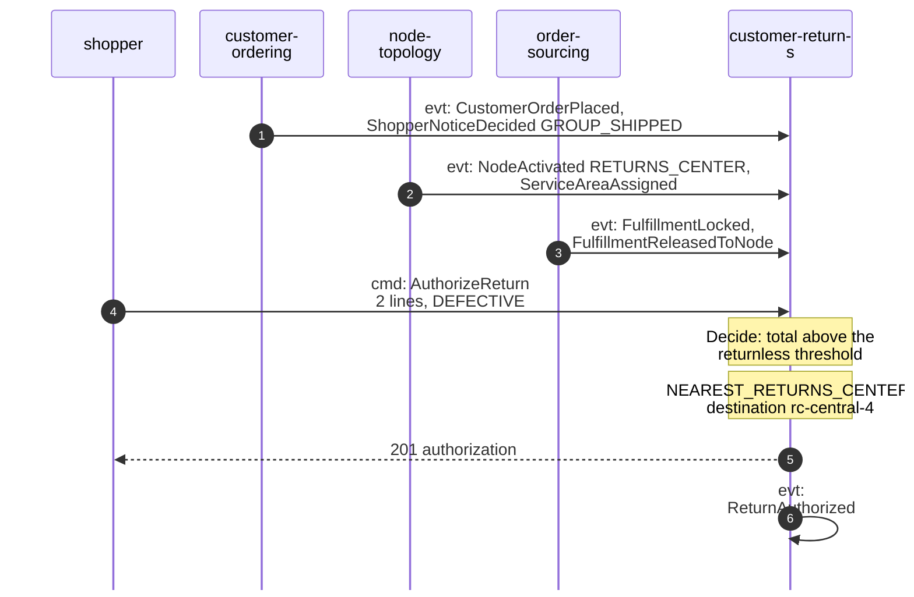
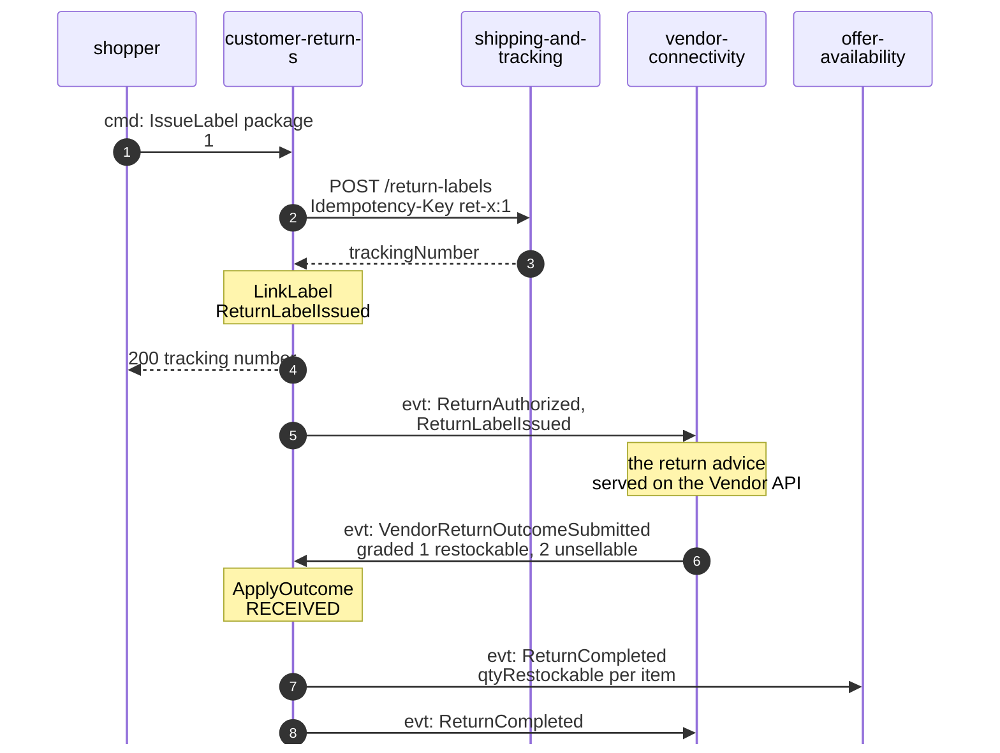
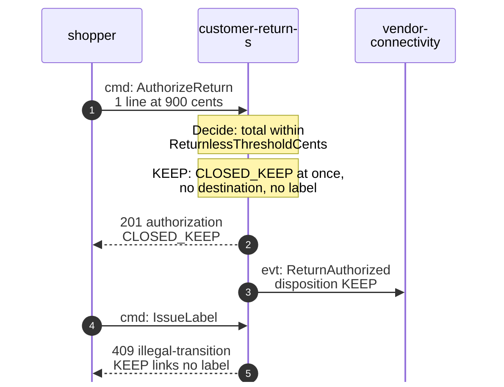
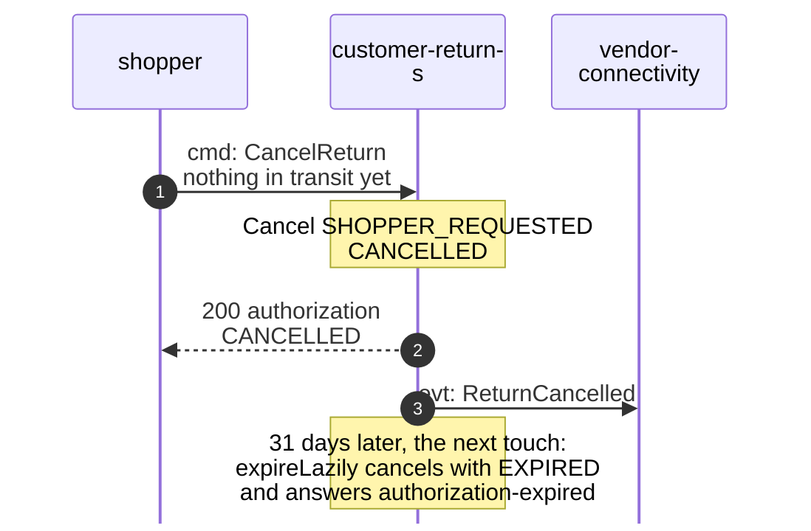

# Domain Message Flow

Following ddd-crew [Domain Message Flow Modelling](https://github.com/ddd-crew/domain-message-flow-modelling). Every
arrow is a message of this context, prefixed `cmd:`, `evt:` or `qry:`. Quantities and identifiers in the notes are
illustrative. Full event types are on [Domain events](/docs/ddd/domain-events); the runtime view with errors is on
[Sequence diagrams](/docs/ddd/sequence-diagrams). The vendor-side steps (the returns centre working the advice and
submitting through the Vendor API) belong to vendor-connectivity and are shown only as far as they reach this context.

## 1. A physical return, authorize to restock

### 1a. Authorize

Source: `internal/adapters/inbound/kafka/consumers.go` (the read models), `internal/application/usecases/authorize.go`
(`AuthorizeReturn`, `resolveLines`, `destinations`), `internal/domain/returnauthorization/decide.go`.

### 1b. Label, grade and restock

Source: `internal/application/usecases/{labels,outcome}.go`, `internal/adapters/outbound/labels`,
`internal/adapters/outbound/kafka/encoder.go` (topic routing).

## 2. The returnless KEEP

Source: `internal/domain/returnauthorization/decide.go` (`keepEligible`), `commands.go` (`LinkLabel` on KEEP). The
missing-price case is the same flow refused earlier: `pricesAbsent` makes KEEP impossible and the fallback dispositions
apply.

## 3. Cancellation and lazy expiry

Source: `internal/application/usecases/queries.go` (`CancelReturn`, `expireLazily`), `labels.go` (`expireAndReject`).
There is no sweeper: expiry is checked on every read, label and outcome touch
([ADR 0002](/docs/adr/0002-aggregates-and-invariants) A4).
