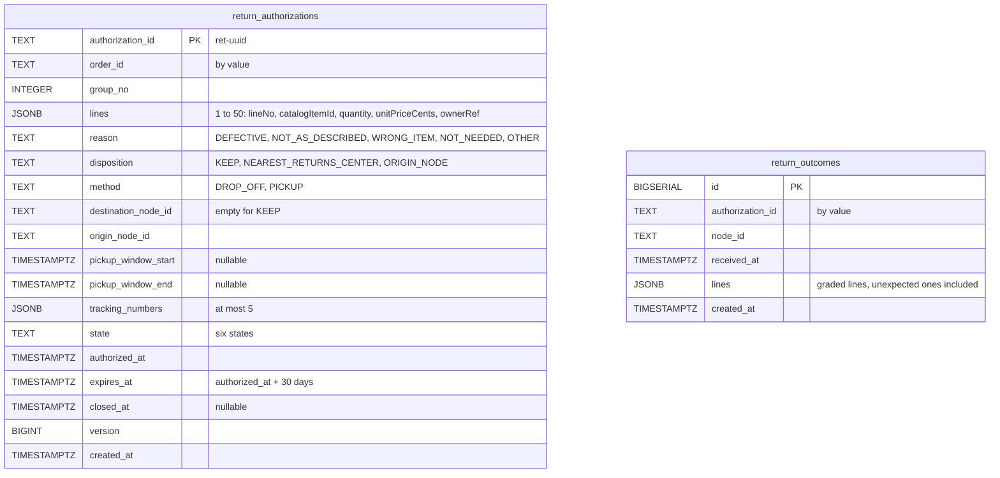
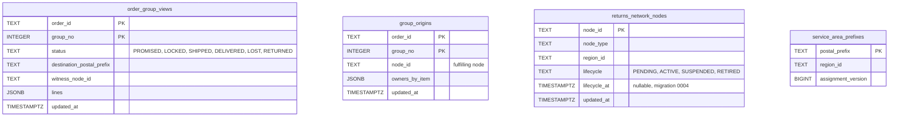
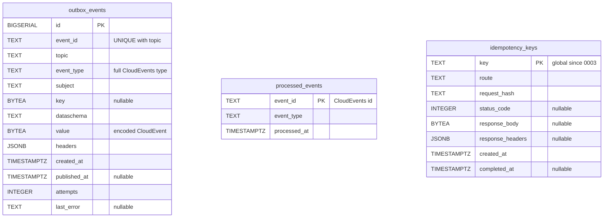
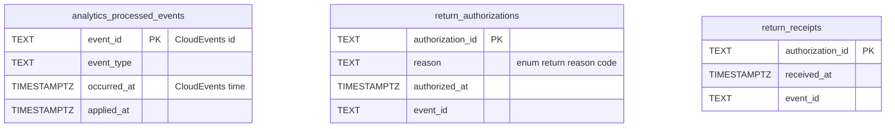

# Entity Relationship

The schema of this context's own Postgres database, as created by the four embedded migrations in
`internal/adapters/outbound/postgres/migrations/`: `0001_customer_returns_schema` (the aggregate, the read models and the
outcome facts), `0002_customer_returns_stem` (outbox, inbox, idempotency keys), `0003_idempotency_key_global` (the
`Idempotency-Key` becomes the primary key on its own) and `0004_node_status_facts` (`returns_network_nodes.lifecycle_at`,
and the node type check dropped so the type is stored as node-topology publishes it). Nine tables, no foreign keys: the
aggregate is one row with its lines as `JSONB`, and ids of other contexts are held by value.

The aggregate and the outcome facts:

Read models fed by consumed events ([ADR 0003](/docs/adr/0003-consumed-contracts-and-local-read-models)):

Outbox, inbox and idempotency (infrastructure tables):

Source: the four migrations above. The idempotency rows are purged after 24 hours by the retention sweep in `cmd/api`
(see [Runbook](/docs/operations/runbook)). The check constraints of `return_authorizations` (a `KEEP` closes at once and
has no destination, a `PICKUP` needs a window, `IN_TRANSIT` needs a tracking number, terminal states carry `closed_at`)
are in `0001`. Column details of the outbox and consumer behaviour are on
[Troubleshooting](/docs/operations/troubleshooting).

## Analytical database tables

The analytical database is separate from the OLTP one (ADR 0012, optional, default off). It is a projection of this
context's own topic `retailnetwork.customer-returns.events`, written only by `cmd/projector` and read read-only by
`cmd/reports`; it can be dropped and rebuilt from the topic.

Source: `analytics/migrations/0001_return_facts.up.sql`, `internal/adapters/outbound/analyticsstore/projection.go`,
`reader.go`. The migration declares no foreign keys, so no relationship line is drawn. The tables are related by value:
the report left-joins `return_receipts` to `return_authorizations` on `authorization_id` for the time to receive, and a
receipt without its authorization counts as received but has no timing.

- `analytics_processed_events` is the idempotency claim: the projector inserts the event id (`ON CONFLICT (event_id) DO
  NOTHING`) in the same transaction as the fact it projects, so a replayed id is a no-op. `max(occurred_at)` is the basis
  of the freshness report.
- `return_authorizations` has one row per authorization from `ReturnAuthorized`, upserted on `authorization_id`;
  `authorized_at` is the payload's `authorizedAt`.
- `return_receipts` has one row per authorization from `ReturnCompleted`, upserted on `authorization_id`; `received_at` is
  the payload's `receivedAt`.
- `authorization_id`, `reason` are `CHECK (... <> '')` non-empty. Three indexes:
  `idx_return_authorizations_authorized_at`, `idx_return_receipts_received_at` and
  `idx_analytics_processed_events_occurred_at`.
