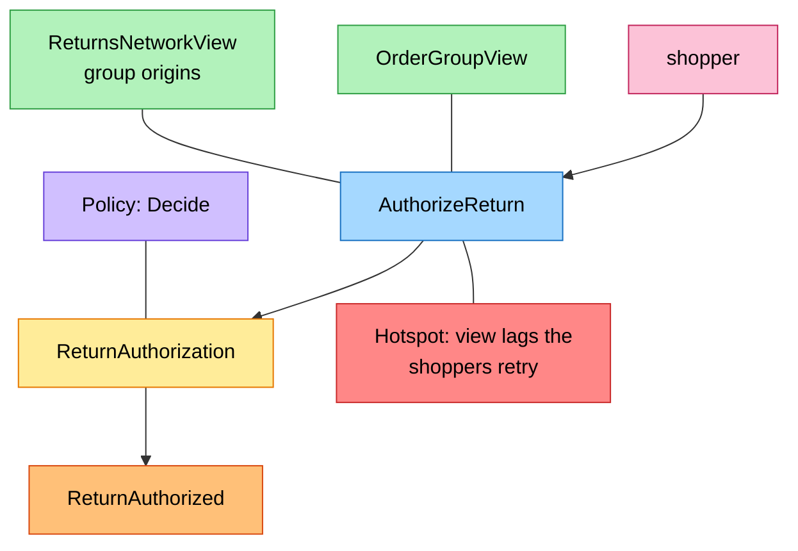
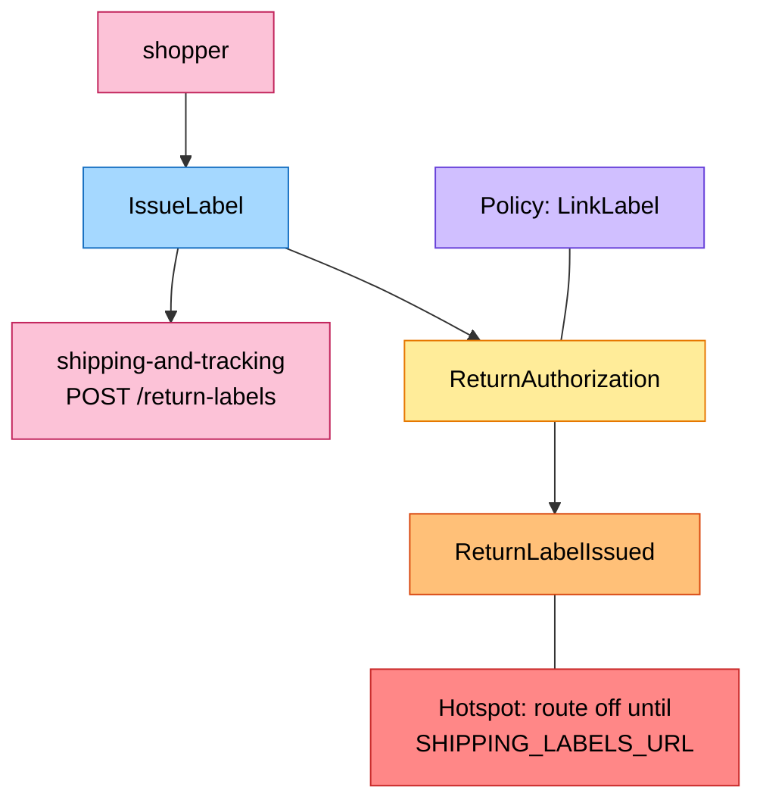
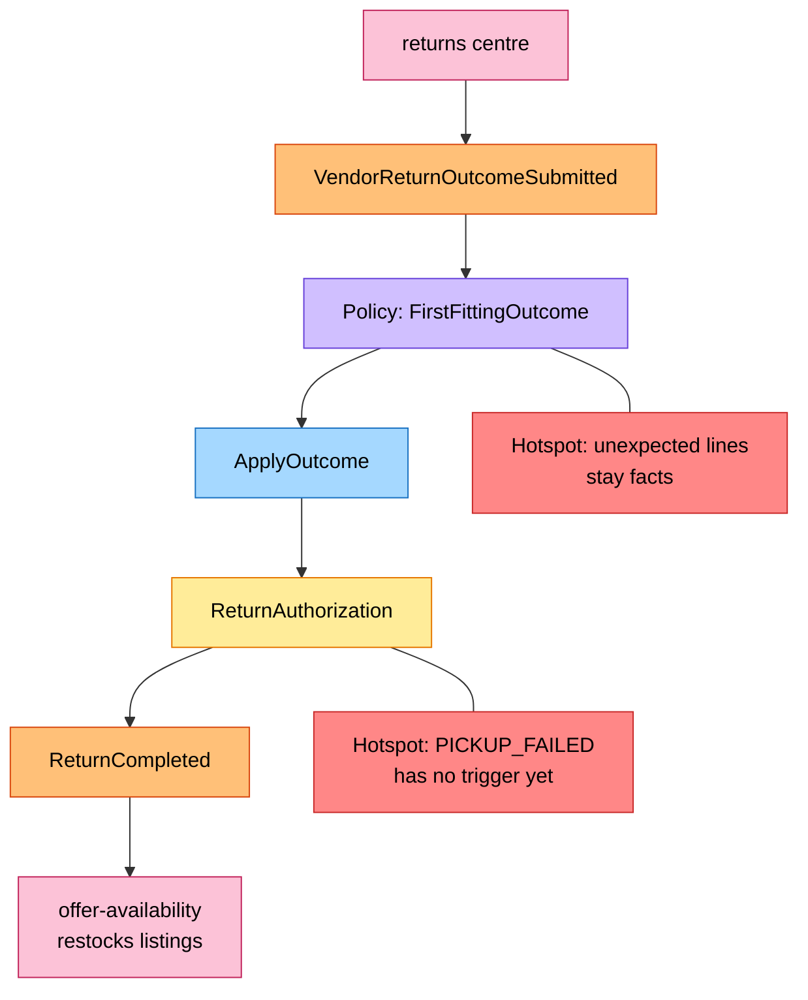

# EventStorming

Process-level boards in the ddd-crew [EventStorming glossary & cheat sheet](https://github.com/ddd-crew/eventstorming-glossary-cheat-sheet)
notation. Every sticky is a command, aggregate, event, policy or read model that exists in the code; the hotspots are
the open questions of this repository's ADRs and of the network design. The network-wide board is
[EventStorming big picture](https://iqvo.github.io/warehouse-docs/network/strategic-design/eventstorming-big-picture).

| Sticky | Colour | Meaning here |
| --- | --- | --- |
| Command | blue `#a5d8ff` | `AuthorizeReturn`, `IssueLabel`, `CancelReturn`... |
| Aggregate | yellow `#ffec99` | `ReturnAuthorization` |
| Domain Event | orange `#ffc078` | an event published or consumed |
| Policy | lilac `#d0bfff` | a rule applied by a use case |
| Read Model | green `#b2f2bb` | `OrderGroupView`, `ReturnsNetworkView`, `group_origins` |
| External System | pink `#fcc2d7` | another context or an actor |
| Hotspot | red `#ff8787` | an open question |

## 1. Authorize

Source: `internal/application/usecases/authorize.go`. `Decide` is a pure function over the read models' destinations —
it performs no I/O, so the authorize use case is one unit of work. A group is authorizable only while its view says
SHIPPED or DELIVERED (`group-not-shipped`).

## 2. Label and transit

Source: `internal/application/usecases/labels.go`, `internal/adapters/outbound/labels` (ADR 0005). While the route is
not configured the answer is the tolerant `422 label-unavailable` — no 500, no retry storm, no outbox row. `MarkInTransit`
raises no event: transit is observed, not commanded.

## 3. Outcome and restock

Source: `internal/application/usecases/outcome.go` (`OnOutcomeSubmitted`, `commitOutcome`, `recordUnexpected`). The
first graded outcome that fits an open authorization completes it; later outcomes and outcomes for unknown or closed
authorizations are recorded on the outcome facts and acknowledged — never a consumer error (ADR 0002 A6 and A7).

## Hotspots

| Hotspot | Where it comes from |
| --- | --- |
| A lagging `OrderGroupView` refuses authorization | The view may lag customer-ordering's facts; the shopper retries with the same `Idempotency-Key` instead of the context blocking ([ADR 0003](/docs/adr/0003-consumed-contracts-and-local-read-models)) |
| The reverse-label route is config-gated | `SHIPPING_LABELS_URL` empty answers `label-unavailable`; honest until the route ships ([ADR 0005](/docs/adr/0005-the-reverse-label-route), [Troubleshooting](/docs/operations/troubleshooting)) |
| Unexpected lines stay facts | Nothing here re-stocks or re-decides from them; the warehouse fleet's exception flow owns them downstream (ADR 0002 A7) |
| PICKUP is dormant | `PICKUP_FAILED` waits for the last-mile pickup wave's `PackageReturnInitiated` (ADR 0002) |
| No money moves here | Fees and prices are facts; the refund itself is another context's decision (ADR 0001) |
