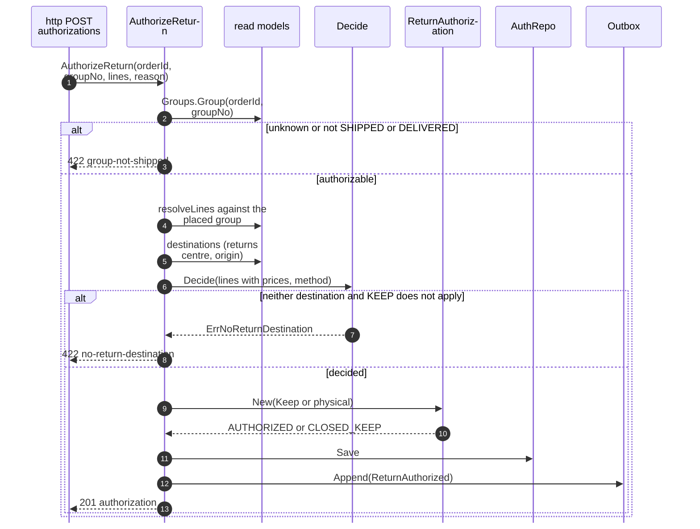
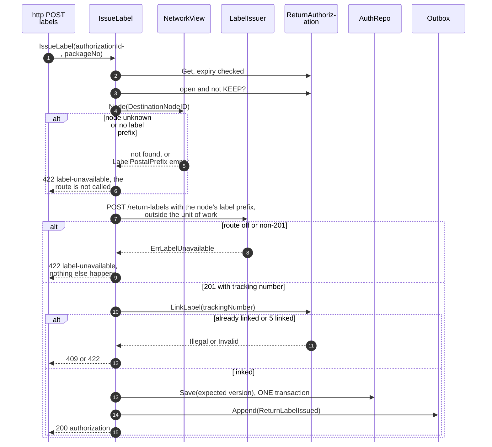
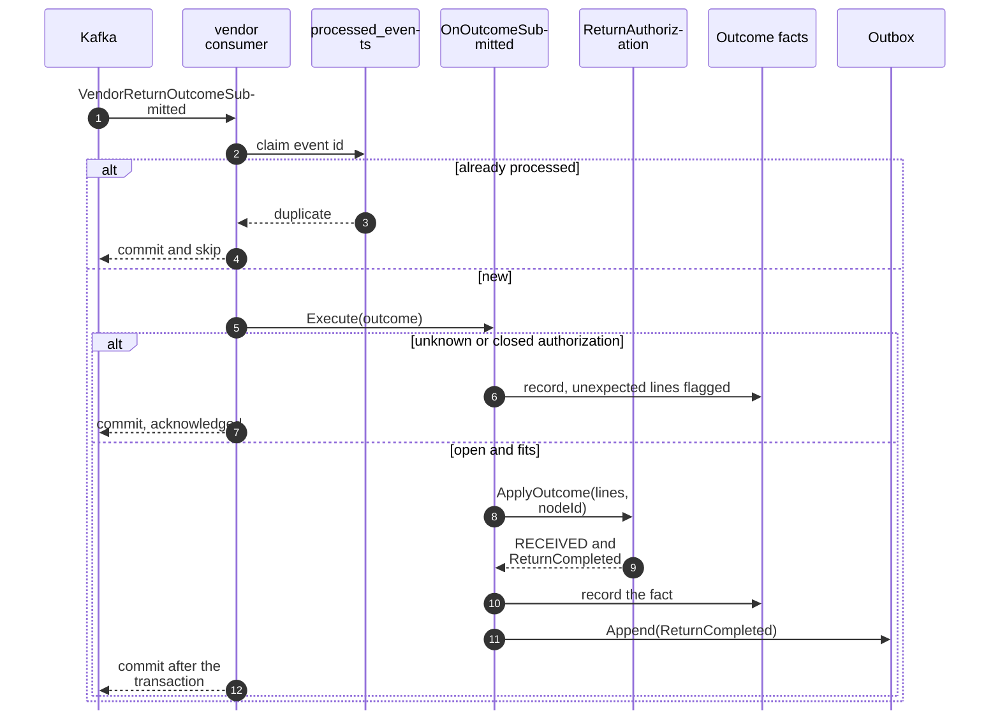
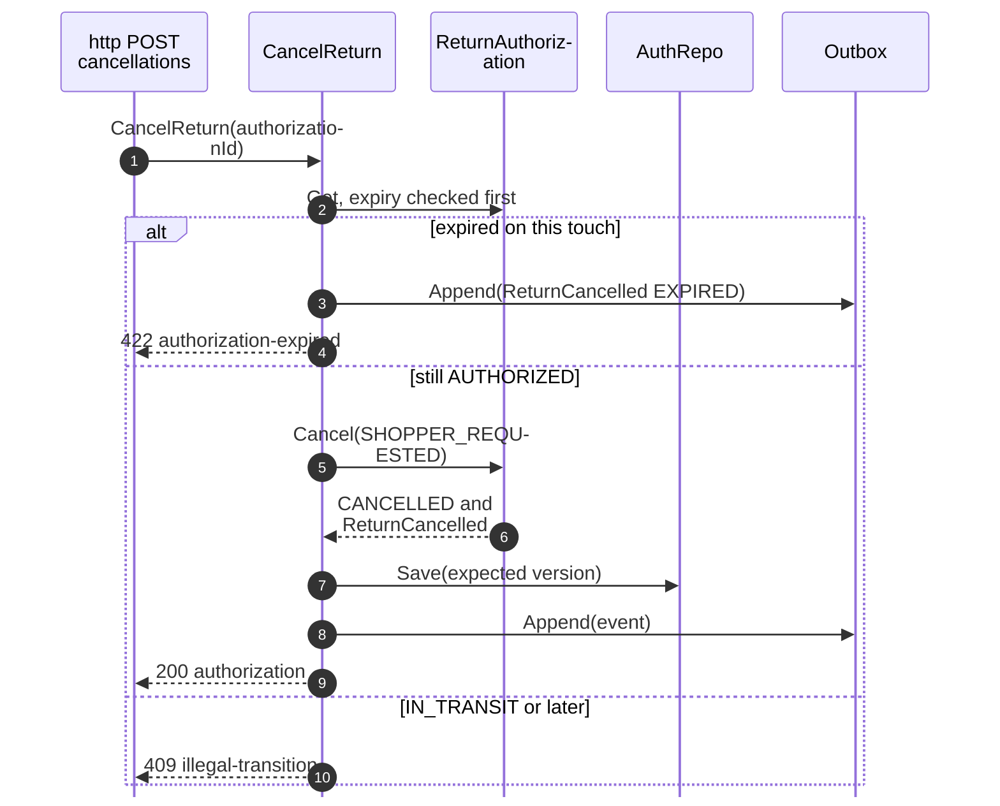

# Sequence Diagrams

Shared conventions, from the code:

- Every command use case runs inside `Service.atomically`, one Postgres transaction (`UnitOfWork`). The repository
  saves with an optimistic `version`; a lost race is `concurrent-update` (409).
- Outbox rows are written in the same transaction as the aggregate (`EventOutbox.Append`); the in-process relay
  publishes them later to `retailnetwork.customer-returns.events`.
- Write routes pass the HTTP idempotency middleware first (`Idempotency-Key`, global, `409` on reuse); it is omitted
  from the diagrams.
- Consumers claim the CloudEvents `id` in `processed_events` in the same transaction as their effect.
- Every command touch re-checks expiry first (`expireLazily`): past `expiresAt` the authorization is cancelled with
  `EXPIRED` and the call answers `authorization-expired`; a pure read reports the remaining state without cancelling.
- Event names are short; full types are on the [Event catalogue](/docs/api-reference/events).

## 1. AuthorizeReturn

Source: `internal/application/usecases/authorize.go`, `internal/domain/returnauthorization/decide.go`. The disposition is
decided here, never chosen by the caller; KEEP closes the aggregate at once.

## 2. IssueLabel

Source: `internal/application/usecases/labels.go`, `internal/adapters/outbound/labels`
([ADR 0005](/docs/adr/0005-the-reverse-label-route)). The destination prefix sent is the destination node's
(`returns_network_nodes.label_postal_prefix`), never the order group's. The client sends
`Idempotency-Key: <authorizationId>:<packageNo>`; a retry is a replay, and a failure between the call and the commit is
healed by the shipping context's dedupe.

## 3. OnOutcomeSubmitted (consumer)

Source: `internal/adapters/inbound/kafka/consumer.go`, `internal/application/usecases/outcome.go`. The first outcome
that fits completes the authorization (ADR 0002 A6); lines beyond the authorization are recorded `unexpected` and never
published (A7). The same inbox pattern runs in the three read-model consumers.

## 4. CancelReturn and the lazy expiry

Source: `internal/application/usecases/queries.go` (`CancelReturn`, `expireLazily`). There is no sweeper: the lazy
expiry is the only other cancellation cause in v1 (ADR 0002 A4).
