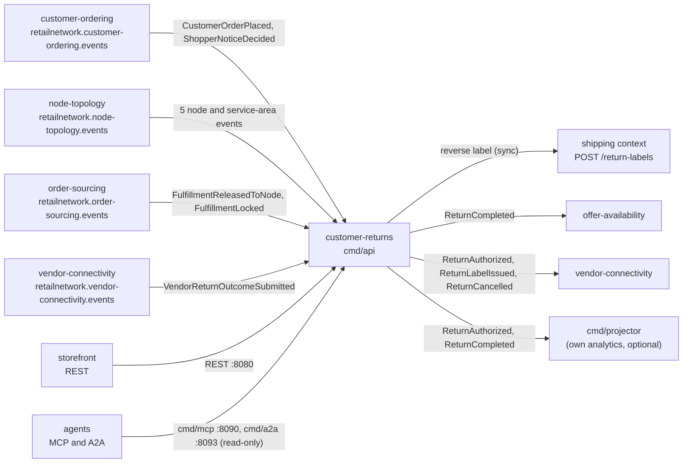

# Integration

customer-returns talks to its neighbours through Kafka and its own interfaces, with exactly **one** synchronous call to
a sibling context: the shipping context's reverse-label route `POST /return-labels`
(`internal/adapters/outbound/labels`, [ADR 0005](/docs/adr/0005-the-reverse-label-route)), off while
`SHIPPING_LABELS_URL` is empty. The order, node and origin facts it needs arrive as events into local tables
([ADR 0003](/docs/adr/0003-consumed-contracts-and-local-read-models)); an authorization made against a view that has not
caught up is refused (`group-not-shipped`, `no-return-destination`), not slowed.

Contracts: `apis/asyncapi.yaml` for events, `apis/openapi.yaml` for REST. Every message is CloudEvents 1.0 in structured
mode, built and decoded only in `internal/adapters/kafka/cloudevents`; the type is
`com.retailnetwork.<tier>.<context>.<entity>.<EventName>` and the Kafka key is the subject (the aggregate id).

Source: `internal/adapters/inbound/kafka/consumers.go`, `internal/adapters/outbound/kafka/encoder.go`,
`internal/adapters/outbound/labels/client.go`, `apis/asyncapi.yaml`, and the consumers on `origin/develop` of
`IQVO/offer-availability` (`internal/adapters/inbound/kafka/returns_consumer.go`) and `IQVO/vendor-connectivity`
(`internal/adapters/inbound/kafka/returns_consumers.go`).

## Upstream: what customer-returns consumes

Four consumers run in `cmd/api`, each under a mandatory stable consumer group ([Runbook](/docs/operations/runbook)).
Each message is claimed in `processed_events` by its CloudEvents id in the same transaction as its effect, so delivery
is at-least-once with an atomic effect.

| Producer | Topic | Event types consumed | Effect |
| --- | --- | --- | --- |
| customer-ordering | `retailnetwork.customer-ordering.events` | `com.retailnetwork.commerce.customer-ordering.customerorder.CustomerOrderPlaced`, `com.retailnetwork.commerce.customer-ordering.order.ShopperNoticeDecided` | Folded into `order_group_views` (group status, destination postal prefix, lines). |
| node-topology | `retailnetwork.node-topology.events` | `com.retailnetwork.logistics.node-topology.node.NodeRegistered`, `NodeActivated`, `NodeSuspended`, `NodeRetired`, `com.retailnetwork.logistics.node-topology.servicearea.ServiceAreaAssigned` | Folded into `returns_network_nodes` and `service_area_prefixes` (`ReturnsNetworkView`). |
| order-sourcing | `retailnetwork.order-sourcing.events` | `com.retailnetwork.commerce.order-sourcing.assignment.FulfillmentReleasedToNode`, `FulfillmentLocked` | Folded into `group_origins` (fulfilling node, per-item owners). |
| vendor-connectivity | `retailnetwork.vendor-connectivity.events` | `com.retailnetwork.partner.vendor-connectivity.returnoutcome.VendorReturnOutcomeSubmitted` | The first fitting outcome completes the authorization and publishes `ReturnCompleted`; every outcome is recorded in `return_outcomes`. An outcome for an unknown or closed authorization is recorded and acknowledged, never a consumer error ([Use cases](/docs/ddd/use-cases)). |

Payloads are decoded tolerantly: unknown fields are ignored, and a type a consumer has no handler for is committed past
without a log line.

**Failure behaviour (all four consumers).** The offset is committed only after the effect committed. A transient
failure (database error) is retried with capped exponential backoff, 200 ms doubling to 5 s, up to 5 attempts, then the
message goes to `<topic>.dlq` with the headers `x-dlq-source-topic`, `x-dlq-source-partition`, `x-dlq-source-offset`,
`x-dlq-error` and `x-dlq-failed-at`. A message that is not a valid CloudEvent is skipped and logged at WARN; a payload
that can never be applied is dead-lettered at once. A lost broker connection is retried up to 10 consecutive times, then
the consumer ends and the process exits non-zero so the orchestrator restarts it.

**Cold start.** Until customer-ordering has published the group as SHIPPED or DELIVERED, an authorization is refused
`group-not-shipped`; until node-topology has published an ACTIVE returns centre for the region (or order-sourcing the
origin node), it is refused `no-return-destination`. There is no live lookup to fall back on.

## Downstream: what customer-returns publishes

Events are written to `outbox_events` in the same transaction as the aggregate and relayed to Kafka by the in-process
relay (`OUTBOX_RELAY_INTERVAL`, rows retried up to `OUTBOX_MAX_ATTEMPTS`). Writers use `RequiredAcks: all` and auto-create
the topic on first write; delivery is at-least-once with a stable id. See [Events](/docs/api-reference/events) for every
payload.

| Topic | Events | Known consumers (`origin/develop`) |
| --- | --- | --- |
| `retailnetwork.customer-returns.events` | `ReturnAuthorized`, `ReturnLabelIssued`, `ReturnCompleted`, `ReturnCancelled` | offer-availability (`ReturnCompleted`, the restock fact); vendor-connectivity (`ReturnAuthorized`, `ReturnLabelIssued`, `ReturnCancelled`); this context's own `cmd/projector` (`ReturnAuthorized`, `ReturnCompleted`, ADR 0012) |

`retailnetwork.customer-returns.analytics` is declared in the encoder (`TopicAnalytics`) but no event is published to it
in v1. If Kafka is down the writes are still accepted and the events wait in the outbox.

## Interfaces it exposes

| Interface | Binary | Address | Consumers |
| --- | --- | --- | --- |
| REST returns API | `cmd/api` | `:8080`; Kong route `/api/customer-returns` with the prefix stripped (`warehouse-infra`) | the storefront |
| Reports (read-only) | `cmd/reports` | `:8092`, `/reports/*`; Kong route `/api/customer-returns/reports` when `analytics.reports.route.enabled` | analysts, dashboards |
| MCP (read-only, Streamable HTTP) | `cmd/mcp` | `:8090`, `/mcp`; Kong route `/api/mcp/customer-returns` | agents |
| A2A (read-only, JSON-RPC 2.0) | `cmd/a2a` | `:8093`, `/` and `/a2a`; Agent Card `/.well-known/agent-card.json`; Kong route `/api/a2a/customer-returns` | any delegating agent |

All four are unauthenticated. See [API reference](/docs/api-reference) and [MCP tools](/docs/mcp/tools).

## Edges that do not exist

- **The warehouse-systems fleet.** This service belongs to the retail network; nothing in this repository references a
  fleet service.
- **Synchronous reads of customer-ordering, node-topology or order-sourcing.** None: local read models only.
- **Outbound A2A or MCP clients.** None (`TestA2AAgentIsReadOnlyAndHasNoOutboundClient`). This context is delegated to
  and never delegates.
- **Money.** No event carries a unit price; refunds are customer-payments' and not integrated here.
- **Downstream consumers of the analytics topic.** None (nothing is published there).
