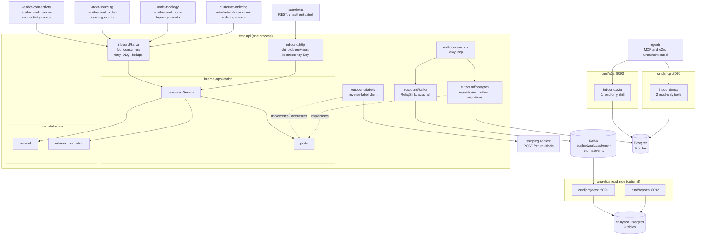

# Architecture

customer-returns follows the fleet's hexagonal (ports and adapters) layout: dependencies point inward, the domain imports
nothing from the rest of the module, and only `cmd/` wires the layers together. Everything on this page is on `develop`.

## Layout

| Layer | Path | Role |
| --- | --- | --- |
| Domain | `internal/domain/returnauthorization` | The `ReturnAuthorization` aggregate (six states), its commands, invariants, the pure `decide` and the four events `ReturnAuthorized`, `ReturnLabelIssued`, `ReturnCompleted`, `ReturnCancelled`. |
| Domain | `internal/domain/network` | The read-model value types (`Node`, returns-network rows) folded from neighbours' events. |
| Domain | `internal/domain/returnsperformance` | The pure analytics read model: KPI and range rules and its ports ([ADR 0012](/docs/adr/0012-analytics-read-side-and-return-rate-facts)). |
| Domain | `internal/domain/shared` | `ErrValidation`, `ErrIllegalTransition` and shared value rules. |
| Application | `internal/application/usecases` | One method of `Service` per command, query or consumed event ([Use cases](/docs/ddd/use-cases)). |
| Application | `internal/application/{ports,requests,views,outbox}` | The out ports (`AuthorizationRepository`, `GroupViewRepository`, `NetworkViewRepository`, `OutcomeFacts`, `LabelIssuer`, `EventOutbox`, `ProcessedEvents`, `UnitOfWork`, `Clock`, `ReturnMetrics`, `IDGenerator`), the request and view structs, and the already-encoded outbox `Message`. |
| Inbound adapter | `internal/adapters/inbound/http` | chi router for `apis/openapi.yaml`: handlers, problem mapping (`errors.go`), the `Idempotency-Key` middleware and replay classes (`idempotency.go`, `replay_class.go`), `/healthz`, `/readyz`. No auth middleware. |
| Inbound adapter | `internal/adapters/inbound/kafka` | The customer-ordering, node-topology, order-sourcing and vendor-connectivity consumers and the analytics consumer: CloudEvents decode, dispatch on the full `type`, retry with backoff, dead-letter topic, consumer span. |
| Inbound adapter | `internal/adapters/inbound/mcp` | The two read-only MCP tools, one resource and one prompt. |
| Inbound adapter | `internal/adapters/inbound/a2a` | The one read-only A2A skill and the Agent Card. |
| Inbound adapter | `internal/adapters/inbound/reportshttp` | The read-only `/reports/*` routes of `cmd/reports`. |
| Inbound adapter | `internal/adapters/inbound/requestlog` | The access-log middleware shared by the routers. |
| Outbound adapter | `internal/adapters/outbound/postgres` | pgxpool repositories, unit of work (`pgtx`), outbox and inbox repositories, embedded migrations. |
| Outbound adapter | `internal/adapters/outbound/analyticsstore` | The analytical-database writer and reader (+ an in-memory twin held to one contract suite). |
| Outbound adapter | `internal/adapters/outbound/kafka` | `Encoder` (domain event to CloudEvents outbox message), `NewWriter`, `RelaySink`, the Kafka half of `/readyz`. |
| Outbound adapter | `internal/adapters/outbound/outbox` | The relay loop that drains `outbox_events`. |
| Outbound adapter | `internal/adapters/outbound/labels` | The ONE in-org HTTP client: the shipping context's reverse-label route, off while `SHIPPING_LABELS_URL` is empty ([ADR 0005](/docs/adr/0005-the-reverse-label-route)). |
| Outbound adapter | `internal/adapters/outbound/telemetry` | OpenTelemetry setup, the `customer_returns.return.authorized` counter, the trace-correlating slog handler. |
| Outbound adapter | `internal/adapters/outbound/{clock,ids}` | `Clock` and id generation (`ret-<uuid>`). |
| Outbound adapter | `internal/adapters/outbound/memory` | In-memory implementation of the ports: a **test double** for the unit and BDD suites. No `cmd/**` binary imports it (`TestRuntimeBinaryHasNoInMemoryAdapters`). |
| Kafka envelope | `internal/adapters/kafka/cloudevents` | The only place a CloudEvents 1.0 envelope is built or decoded. |
| Support | `internal/bootretry` | Exponential-backoff retry for the first outbound dials at boot. |
| Composition roots | `cmd/api`, `cmd/mcp`, `cmd/a2a`, `cmd/projector`, `cmd/reports` | See below. |
| Test support | `internal/testing/{kafkatest,pgtest,repocontract}` | Shared testcontainers helpers and repository contract suites. |
| Fitness tests | `internal/architecture` | arch-go and source-scanning tests. |

The out ports are interfaces in `internal/application/ports/ports.go`; the label issuer, the clock, id generation and the
return counter are ports too, so the use cases never touch infrastructure.

## Binaries and ports

| Binary | Role | Port | Probes |
| --- | --- | --- | --- |
| `cmd/api` | REST API, the four consumers, the outbox relay and the retention sweeper in one process, all always on, on real Postgres and Kafka. Files: `main.go` (run and shutdown order), `config.go` (env parsing, `loadRuntime`), `wire_adapters.go`, `wire_background.go`, `telemetry.go`. | `HTTP_ADDR`, default `:8080` | `GET /healthz` (liveness), `GET /readyz` (drain gate, Postgres ping, a Kafka broker answers a metadata request; never topics) |
| `cmd/mcp` | Read-only MCP server (Streamable HTTP on `/mcp`) over the read use cases; no relay, consumer or Kafka ([ADR 0006](/docs/adr/0006-read-only-mcp-server)). | `MCP_ADDR`, default `:8090` | `GET /healthz` |
| `cmd/a2a` | Read-only A2A (Agent2Agent) agent: JSON-RPC 2.0 at `/` and `/a2a`, Agent Card at `/.well-known/agent-card.json`; no relay, consumer or Kafka ([ADR 0009](/docs/adr/0009-a2a-inbound-adapter)). | `A2A_ADDR`, default `:8093` | `GET /healthz` |
| `cmd/projector` | Analytics projector (optional, `analytics.enabled`): folds this context's own `retailnetwork.customer-returns.events` into the separate analytical database; never opens the OLTP database ([ADR 0012](/docs/adr/0012-analytics-read-side-and-return-rate-facts)). | `ADMIN_ADDR`, default `:8091` | `GET /healthz`, `GET /readyz` |
| `cmd/reports` | Read-only `GET /reports/returns-performance` and `/reports/freshness` over the analytical database; no Kafka, no OLTP database (ADR 0012). | `HTTP_ADDR`, default `:8092` | `GET /healthz`, `GET /readyz` |

There is no `web/` remote in this repository. How `cmd/api` boots and stops is in [Runtime](/docs/overview/runtime);
every variable is in [Configuration](/docs/operations/configuration).

## Container diagram

Source: `cmd/api/{main,wire_adapters,wire_background}.go` (wiring and workers), `cmd/mcp/main.go`, `cmd/a2a/main.go`,
`cmd/projector/main.go`, `cmd/reports/main.go`, `internal/application/ports/ports.go` (the out ports),
`internal/adapters/outbound/kafka/encoder.go`, `internal/adapters/outbound/outbox/relay.go` and
`internal/architecture/architecture_test.go`. The in-memory adapters are not in the diagram because no binary wires them.
`cmd/mcp` and `cmd/a2a` run the same embedded migrations at boot and read through the same repositories.

## Analytics read side (ADR 0012)

Optional and off by default: `cmd/projector` consumes this context's own `retailnetwork.customer-returns.events` into a
second, separate Postgres database (`analytics_processed_events`, `return_authorizations`, `return_receipts`; see the
[entity relationship](/docs/ddd/entity-relationship) page) and `cmd/reports` serves `GET /reports/returns-performance`
and `/reports/freshness` read-only. The pure KPI rules live in `internal/domain/returnsperformance`, which imports no
other internal package; the store is `internal/adapters/outbound/analyticsstore` (writer, reader and an in-memory twin held
to one contract suite) and the routes `internal/adapters/inbound/reportshttp`. Three architecture tests keep it so
(`internal/architecture/analytics_fitness_test.go`): the read model is self-contained, the store depends only on it and the
analytical schema, and the OLTP side never imports either.

## Data stores

One Postgres database owned by this context, created by the embedded migrations
(`internal/adapters/outbound/postgres/migrations/`: `0001_customer_returns_schema`, `0002_customer_returns_stem`,
`0003_idempotency_key_global`, `0004_node_status_facts`):

| Table | Holds |
| --- | --- |
| `return_authorizations` | The `ReturnAuthorization` aggregate: order, group, reason, disposition, method, destination and origin node, pickup window, tracking numbers, state, `expires_at` (= `authorized_at` + 30 days), `version`; the lines live in JSONB. |
| `order_group_views` | `OrderGroupView`: per order group, its status, destination postal prefix and lines (from customer-ordering). |
| `group_origins` | The fulfilling node and the per-item owners of each group (from order-sourcing). |
| `returns_network_nodes` | `ReturnsNetworkView` nodes: type, region, lifecycle (+ `lifecycle_at`, migration 0004). |
| `service_area_prefixes` | `ReturnsNetworkView` service areas: postal prefix to region. |
| `return_outcomes` | Every graded outcome received, with unexpected lines kept as facts. |
| `outbox_events` | The transactional outbox; one row per message and destination topic, with `attempts` and `last_error`. |
| `processed_events` | The consumers' inbox: CloudEvents ids already applied. |
| `idempotency_keys` | Stored answers of the `POST` routes (a success or a FINAL/OUTCOME refusal; a RETRYABLE refusal is released, ADR 0013), keyed by the global `key` (migration 0003), kept 24 h. |

Postgres is the only store: the OLTP binaries refuse to boot without `DATABASE_URL` and nothing is served from process
memory. Kafka is the fleet's single broker; `cmd/api` produces to `retailnetwork.customer-returns.events`, consumes
`retailnetwork.customer-ordering.events`, `retailnetwork.node-topology.events`, `retailnetwork.order-sourcing.events`
and `retailnetwork.vendor-connectivity.events`, and never creates a topic through an admin API.

## Rules enforced by `internal/architecture`

The tests run on every PR (`arch-test` job, `make arch-test`); the full list is on [Testing](/docs/development/testing).
The load-bearing ones:

| Rule | Test |
| --- | --- |
| Domain depends only on domain; application only on domain and application; inbound and outbound adapters do not import each other | `TestHexagonalArchitecture` (6 subtests) |
| The MCP and A2A adapters depend only on application and domain, nothing depends on them, and they reach read use cases only | `TestMCPAdapterDependencyRule`, `TestA2AAdapterDependencyRule`, `TestA2AAgentIsReadOnlyAndHasNoOutboundClient` |
| No authentication middleware | `TestNoAuthMiddlewareReintroduced` |
| No binary imports the in-memory adapters | `TestRuntimeBinaryHasNoInMemoryAdapters` |
| CloudEvents 1.0 is the only envelope | `TestNoEventEnvelopeToggleOrFlatEnvelope`, `TestCloudEventsOnly` |
| Every outbox relay passes an attempt cap | `TestOutboxRelaysPassAttemptCap` |
